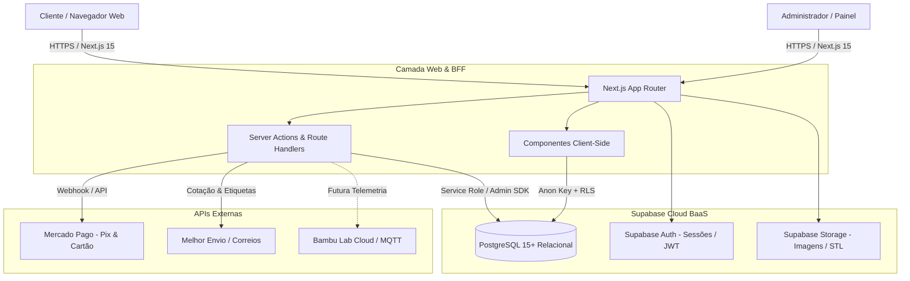

# Arquitetura do Sistema (ARCHITECTURE.md)

## 1. Visão Geral do Sistema

O **3D Commerce** é uma plataforma e-commerce especializada em manufatura sob demanda e pronta entrega de itens impressos em 3D. A arquitetura foi concebida para atender tanto a operação comercial quanto o chão de fábrica (gestão de carretéis, consumo de gramas de filamento, depreciação de máquinas, ordens de produção e validação prévia de demanda de mercado).

---

## 2. Escolha da Stack e Justificativa

| Camada | Tecnologia | Justificativa Técnica |
|---|---|---|
| **Framework Web** | Next.js 15 (App Router, React 19, TypeScript) | Suporte nativo a SSR/SSG para indexação SEO impecável de produtos, Server Actions para regras de negócio seguras sem expor segredos no browser, e excelente desempenho mobile. |
| **Linguagem** | TypeScript (Strict Mode) | Tipagem estática fim a fim compartilhada entre banco (gerada via Supabase CLI types) e interface do usuário. |
| **Banco de Dados** | PostgreSQL (Supabase Cloud) | Modelo relacional robusto com integridade referencial estrita, suporte a transações ACID, constraints de domínio, triggers de auditoria e Row Level Security (RLS). |
| **Autenticação** | Supabase Auth (GoTrue) | Gerenciamento de tokens JWT seguros em cookies HTTP-Only, vinculação atômica com a tabela de perfis de usuário (`public.profiles`). |
| **Armazenamento de Arquivos** | Supabase Storage | Buckets com políticas de acesso específicas para fotos públicas de produtos e documentos privados de auditoria. |
| **Gateways de Pagamento** | Mercado Pago SDK / REST API | Solução primária líder no Brasil para Pix com confirmação instantânea via webhook assinado e parcelamento transparente. Arquitetura desenhada com padrão Adapter para suportar novos provedores sem refatoração. |
| **Estilização** | Vanilla CSS / CSS Modules estruturado com Design System Moderno | Controle refinado de performance, visual glassmorphism moderno, ausência de overhead desnecessário e total fidelidade à identidade visual da loja de impressão 3D. |
| **Testes** | pgTAP / Scripts SQL de integridade + Vitest / Playwright | Garantia de integridade das regras financeiras, restrições de estoque e validação de RLS no banco de dados. |

---

## 3. Divisão de Responsabilidades e Camadas

### 3.1. Camada de Apresentação (Client-Side)
- Renderização de catálogo responsiva e otimizada (mobile-first).
- Gerenciamento de carrinho persistido localmente (com sincronização para usuários autenticados).
- Formulários de interesse (Reserva Gratuita) e simulação de frete.
- Painel Administrativo com gráficos de fluxo de caixa, pedidos, estoque de bobinas e ordens de produção.

### 3.2. Camada de Aplicação / BFF (Server-Side)
- Next.js Server Actions e Route Handlers dedicados.
- Cálculo e validação definitiva de cupons de desconto, frete e totais de pedidos.
- Criação e consulta de transações de pagamento no Mercado Pago.
- Recepção, verificação de assinatura e processamento idempotente de webhooks.
- Operações restritas a administradores verificadas com verificação de perfil e role.

### 3.3. Camada de Dados e Persistência (PostgreSQL & RLS)
- Centralização da lógica de integridade relacional via constraints (`CHECK`, `FOREIGN KEY`, `UNIQUE`).
- Auditoria contínua de movimentações de inventário e bobinas via triggers.
- Função de segurança `public.is_admin()` com `SECURITY DEFINER` para evitar que usuários manipulem sua própria role.
- Separação lógica dos domínios em esquemas bem definidos e índices para consultas de alta performance.

---

## 4. Segurança e Gestão de Segredos

- **Variáveis Públicas (`NEXT_PUBLIC_`):** Limitadas estritamente a `NEXT_PUBLIC_SUPABASE_URL` e `NEXT_PUBLIC_SUPABASE_ANON_KEY`.
- **Variáveis Privadas:** Chaves de serviço (`SUPABASE_SERVICE_ROLE_KEY`), tokens do Mercado Pago (`MERCADO_PAGO_ACCESS_TOKEN`), segredos de webhook (`MERCADO_PAGO_WEBHOOK_SECRET`) permanecem restritas ao ambiente do servidor.
- **Isolamento RLS:**
  - Usuários anônimos e autenticados leem apenas produtos `active = true`, categorias públicas e campanhas em vigor.
  - Usuários autenticados acessam exclusivamente seus próprios pedidos, endereços e reservas.
  - Funções de escrita de catálogo, estoque, compras, financeiro e produção restritas a perfis com `role = 'admin'`.
